::: {.cover}
[UNIVERSITY OF CAPE TOWN]{.uni}\
[Department of Statistical Sciences]{.dept}

[STA5073Z Data Science for Industry]{.course}\
[Assignment 2: Image classification with neural networks]{.assn}

[Writer Identification from Handwriting]{.title}

| Group member      | Student number | Main responsibilities                         |
|:------------------|:---------------|:----------------------------------------------|
| Daniele Sguazzin  | SGZDAN001      | Siamese network, hyperparameter search        |
| Lucas Henze       | HNZLUC002      | Data exploration, CNN, CNN hyperparameter search |

::: {.meta}
|                     |                                                              |
|--------------------:|:-------------------------------------------------------------|
| Date                | 16 October 2026                                              |
| Word count          | [XXXX] / 5000                                                |
| GitHub repository   | <https://github.com/DanSguazzin17/STA5073Z-Assignment-2>      |
| Report website      | [GitHub Pages link]                                          |
:::
:::

```{r}
#| label: setup
#| include: false

# The report only reads saved results; all models are trained in the task scripts
# (see the appendix on reproducing the results), so rendering takes seconds.
library(here)
library(knitr)
library(dplyr)
library(tidyr)

read_result <- function(...) readRDS(here::here(...))

# Formatting helpers for inline numbers
pct <- function(x, digits = 1) paste0(formatC(100 * x, format = "f", digits = digits), "%")
pp  <- function(x, digits = 1) paste(formatC(100 * x, format = "f", digits = digits), "pp")
pct_range <- function(x, digits = 0) paste0(formatC(100 * min(x), format = "f", digits = digits), "–",
                                            formatC(100 * max(x), format = "f", digits = digits), "%")

exploration <- read_result("task_1", "results", "exploration_results.rds")
baseline    <- read_result("task_2", "results", "cnn_results.rds")
final       <- read_result("task_2", "results", "cnn_final_results.rds")
curves      <- read_result("task_2", "results", "learning_curves.rds")
tuning      <- read_result("task_5", "results", "tuning_results.rds")
```

```{r}
#| label: numbers
#| include: false

# Every number used in the text is computed here, so text and results cannot drift apart.
# Use them inline as `r pct(acc_final$accuracy_mean)` etc.

# Exploration
pixel        <- exploration$pixel_shares
writer_px    <- pixel$share[pixel$component == "writer"]
session_px   <- pixel$share[pixel$component == "session_in_writer"]
replicate_px <- pixel$share[pixel$component == "replicate"]

grouped  <- exploration$grouped_shares %>% mutate(feature = as.character(feature))
share_of <- function(f, g) grouped$share[grouped$feature == f & grouped$group == g]

detailed      <- exploration$variance_shares %>% mutate(component = as.character(component))
session_main  <- detailed %>% filter(component == "Session") %>% pull(share)
pixel_values  <- exploration$pixel_values

# Split comparison (baseline model, one seed)
split_acc <- baseline$split_comparison %>% summarise(across(c(session, random), mean))

# Final CNN
acc_final <- final$overall %>% filter(training == "sessions 1-4")
acc_13    <- final$overall %>% filter(training == "sessions 1-3")
digit_14  <- final$by_digit %>% filter(training == "sessions 1-4")
writers   <- final$by_writer
n_writers_90 <- sum(writers$accuracy >= 0.9)
agg       <- final$by_n_images
epochs    <- final$config$median_epoch
digit_sd  <- digit_14$accuracy_sd
worst     <- writers %>% slice_min(accuracy, n = 1)
confused  <- writers %>% filter(accuracy < 0.5, top3_accuracy >= 0.9)
pp_range  <- function(x, digits = 1) paste0(formatC(100 * min(x), format = "f", digits = digits), "–",
                                            formatC(100 * max(x), format = "f", digits = digits), " pp")

# CNN architecture with parameter counts (3 x 3 kernels)
conv_params <- function(k_in, k_out) 3 * 3 * k_in * k_out + k_out
architecture <- tribble(
  ~Layer,                             ~Output,          ~Parameters,
  "Input",                            "28 × 28 × 1",    0,
  "Random shift (± 10%, training)",   "28 × 28 × 1",    0,
  "Conv 3 × 3, 16 filters + max pool", "14 × 14 × 16",  conv_params(1, 16),
  "Conv 3 × 3, 32 filters + max pool", "7 × 7 × 32",    conv_params(16, 32),
  "Conv 3 × 3, 64 filters + max pool", "3 × 3 × 64",    conv_params(32, 64),
  "Flatten",                           "576",           0,
  "Dense 64, ReLU + dropout 0.5",      "64",            576 * 64 + 64,
  "Dense 20, softmax",                 "20",            64 * 20 + 20
)
n_params <- format(sum(architecture$Parameters), big.mark = ",")

# Tuning
summ       <- tuning$summary
tuned      <- function(h, v) summ %>% filter(hyperparameter == h, value == v)
acc_base   <- tuned("baseline", "baseline")$mean_accuracy
acc_shift  <- tuned("shift", "0.1")
acc_depth4 <- summ %>% filter(hyperparameter == "depth", startsWith(value, "4"))
seed_sd    <- mean(summ$sd_accuracy)
acc_exact  <- function(h, v) tuned(h, v)$mean_accuracy
acc_depth2 <- summ %>% filter(hyperparameter == "depth", startsWith(value, "2"))
n_configs  <- nrow(summ)
gap        <- baseline$split_comparison$gap
train_acc  <- baseline$history %>% filter(metric == "accuracy", data == "training") %>% pull(value) %>% max()

# Learning curves: epoch with the lowest validation loss per learning rate
min_val_loss <- curves %>%
  filter(data == "validation", metric == "loss") %>%
  slice_min(value, n = 1, by = learning_rate)
min_loss_epoch_default <- min_val_loss$epoch[min_val_loss$learning_rate == levels(curves$learning_rate)[1]]
```


# Declarations {.unnumbered}

## Plagiarism Declaration {.unnumbered}

We declare that this submission is our own work. Where ideas, material or assistance from other sources have been used, these have been acknowledged and referenced.

We understand that we are responsible for all material submitted, including material produced with the assistance of large language models. We have reviewed and checked the content of this submission and take responsibility for its accuracy and originality.

We have not knowingly presented the work of another person as our own.

| Name              | Student number | Signature          | Date            |
|:------------------|:---------------|:-------------------|:----------------|
| Daniele Sguazzin  | SGZDAN001      | D. Sguazzin        | 16 October 2026 |
| Lucas Henze       | HNZLUC002      | [SIGNATURE]        | 16 October 2026 |

## AI Use Statement {.unnumbered}

<!--
Required by the brief FOR EACH TASK: (a) the tool used, (b) what it was used for (specific
subtasks), (c) if and how its outputs were verified, (d) how much of what it produced was used.
Not included in the word count. Fill in one row per task. The owner of each task fills that row.
-->

| Task | Tool(s) | What it was used for | How outputs were checked | Extent used |
|:-----|:--------|:---------------------|:-------------------------|:------------|
| 1. Data exploration | | | | |
| 2. CNN for writer identification | | | | |
| 3. Siamese network | | | | |
| 4. Train/validation/test strategy | | | | |
| 5. Hyperparameter optimisation | | | | |
| 6. Comparing CNN and Siamese results | | | | |
| 7. Git and GitHub collaboration | | | | |
| 8. Written report | | | | |
| 9. GitHub Pages website | | | | |

: AI use by task. {#tbl-ai-use}

# Introduction

In this report we study whether neural networks can learn handwriting differences from images of handwritten digits
and identify the writer when presented with a new unseen digit.

The data set contains 25,000 simulated images of the digits 0 to 4, written by 20 people in five recording sessions. We address two questions. First, we train a convolutional neural network (CNN) to identify the writer of a single digit. Second, we train a Siamese network to decide whether two digits were written by the same person.

Our exploration shows that the handwriting of a writer changes considerably between sessions. We therefore develop all models on sessions 1 to 3, use session 4 for model selection and hyperparameter tuning, and keep session 5 as an unseen test set. The final models are retrained on sessions 1 to 4 and evaluated once on session 5. On this test session, the CNN identifies the correct writer in `r pct(acc_final$accuracy_mean)` of cases, compared to 5% by chance. The Siamese network decides correctly for 98.2% of test image pairs whether they come from the same writer, although this drops clearly when the two images come from different sessions.

The report is structured as follows. @sec-exploration describes the data and its sources of variation, and @sec-train-test explains our train, validation and test strategy. @sec-cnn and @sec-siamese present the two models, and @sec-hyperparameters the hyperparameter tuning. @sec-comparison compares both approaches, and the last section concludes.

# Data Exploration {#sec-exploration}

## Dataset structure

The data set consists of 25,000 grey-scale images of 28 × 28 pixels, with values between 0 (background) and 255 (ink). Each of the 20 writers wrote each of the digits 0 to 4 fifty times in each of five sessions, so every combination of writer, digit and session contains exactly 50 images. The design is fully balanced and there are no missing values. Before fitting any model, we scale the pixel values to [0, 1].

## Variation between writers

A first look at the images already shows clear differences between writers (@fig-examples). Some writers slant their digits to the right, others write upright. Writers also differ in the size of their digits and in how thick and dark their strokes are. To measure these differences, we computed eight simple features for every image: slant, height, width, the horizontal and vertical centre of the ink, the inked area, the total amount of ink and the mean stroke intensity. For each feature we then fitted a three-way ANOVA with digit, writer and session as factors. Because the design is balanced, the sums of squares split uniquely into the contributions of each factor and their interactions.

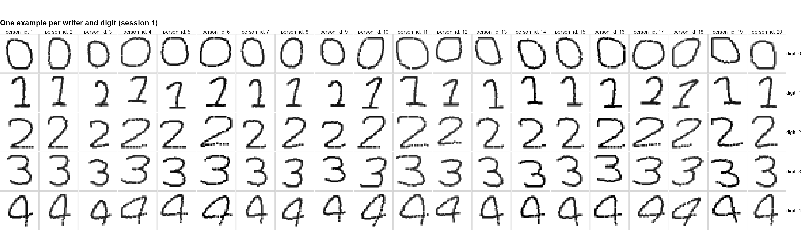{#fig-examples}

@fig-feature-variance shows the result, grouped into four sources. The style features are mainly driven by the writer: the writer explains `r pct(share_of("slant", "Writer"), 0)` of the variance in slant, `r pct(share_of("height", "Writer"), 0)` in height and `r pct(share_of("mean_intensity", "Writer"), 0)` in mean stroke intensity. Size and ink features, in contrast, mostly depend on which digit was written. For example, the digit explains `r pct(share_of("ink_area", "Digit"), 0)` of the variance in inked area, so these features carry little information about the writer. The main effect of session is close to zero for all features (at most `r pct(max(session_main))`). This means that there is no common change that affects all writers in the same way. The interactions between writer and session, however, are clearly present, especially for the position of the digit: terms involving session explain `r pct(share_of("centre_y", "Session drift"), 0)` of the variance in the vertical centre. Each writer therefore changes in their own way from one session to the next.

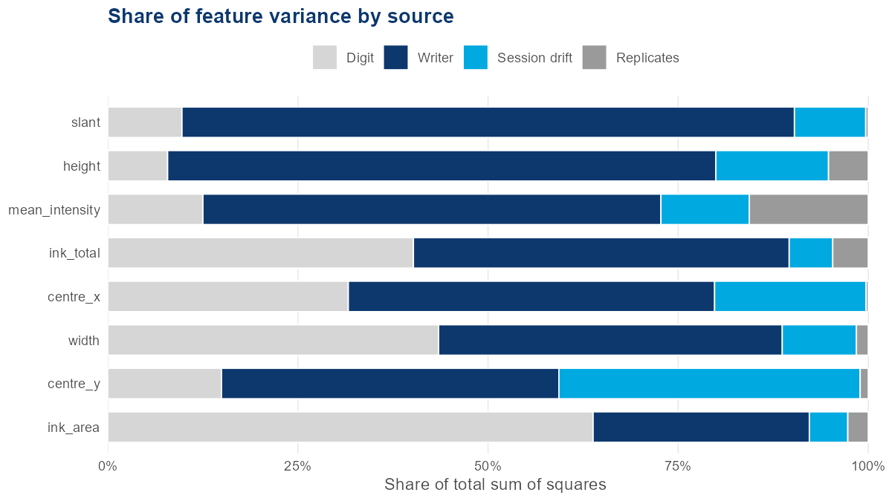{#fig-feature-variance}

## Variation across and within sessions

To check whether this drift also matters for the raw images, which are the input of our models, we decomposed the pixel variance within each digit into three parts: differences between writers, differences between sessions of the same writer, and differences between replicates within the same session (see the [appendix](#sec-appendix-decomposition) for the equations). @fig-pixel-variance shows that `r pct_range(session_px)` of the pixel variance lies between sessions of the same writer. This is more than the variance between writers (`r pct_range(writer_px)`), and it holds for every digit. Replicates within one session explain only `r pct_range(replicate_px)`. @fig-sessions illustrates this: the mean image of the same writer can look quite different in different sessions. In other words, the same writer on a different day can differ more than two different writers. A new session is therefore the hard case for writer identification, and this is the main reason for our split strategy in @sec-train-test.

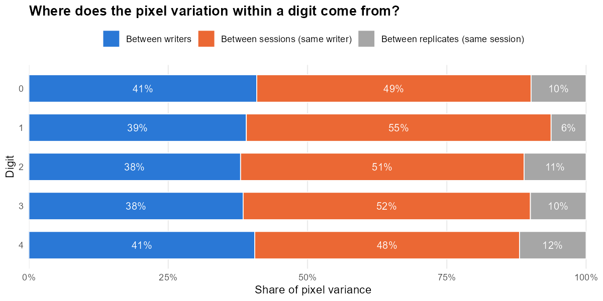{#fig-pixel-variance}

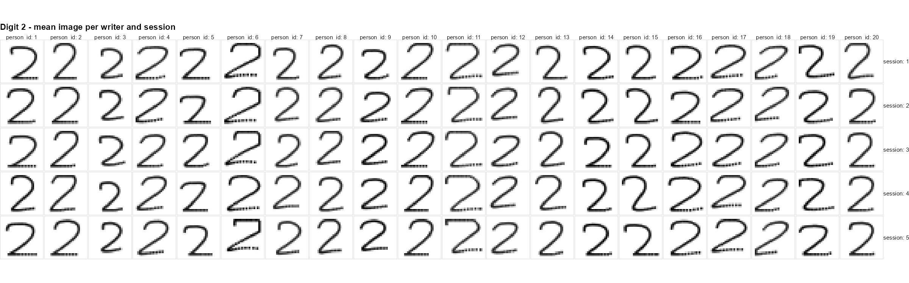{#fig-sessions}

## Limitations of the simulated data

The data are simulated, and several properties show this. The ink values fall into four separated bands with clear gaps between them, plus a spike at the maximum value of 255 (@fig-intensities). Real scans would show a smooth range of grey levels, because ink density varies continuously along and across a stroke. Some strokes are dashed, which does not happen with a pen, and the digit 1 leaves little room for individual style. The replicates within a session are almost identical copies of each other. Effectively, each writer and digit is therefore represented by five independent observations, one per session, rather than by 250 images. Finally, a model could learn properties of the simulator rather than of real handwriting, so our results are likely to be optimistic for real data.

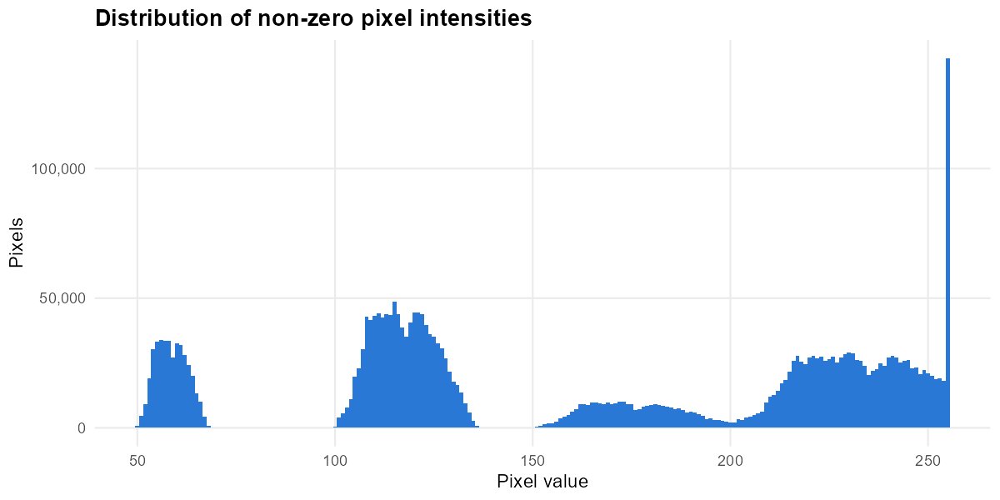{#fig-intensities}

# Train, Validation and Test Strategy {#sec-train-test}

## Chosen split

Our split follows directly from the exploration. Since the hardest case is recognising a known writer in a new session, we split the data by session rather than by image. Sessions 1 to 3 are used for training, session 4 for validation and session 5 as the test set. Each set contains all 20 writers and all five digits, so the only thing that is new in the validation and test sets is the recording session. We use the same split for the Siamese network.

## What kind of generalisation this represents

The validation session is used for all decisions during development: early stopping, model selection and hyperparameter tuning. After these decisions were made, we retrained the final models on sessions 1 to 4 and evaluated it once on session 5. The test session was not used for any decision, so the test accuracy is an unbiased estimate of how well the model identifies known writers on a new day. This defines what kind of generalisation our evaluation represents. It measures closed-set identification: all writers are known from training, but their handwriting comes from a new session. It does not measure how well the model works for new writers. A CNN with 20 output classes cannot recognise a person who was not in the training data. The same applies to the Siamese network, whose test pairs come from the same 20 writers.

## Leakage and optimistic performance

The common (and simpler approach) would be to split the images at random. This, however,
creates a leakage problem, that arises from the fact that images within sessions are 
nearly-identical. Therefore a random split puts those almost-replicates into both the training and
the test set. Hence, the model only has to recognise images it has almost seen before. @tbl-split shows the effect for the baseline CNN: with a random split, the test accuracy is `r pct(split_acc$random)`, compared to `r pct(split_acc$session)` with the session split. A random split would therefore greatly overstate how well the model would actually work in practice.

```{r}
#| label: tbl-split
#| tbl-cap: "Test accuracy of the baseline CNN by digit under a session split and a random image-level split (one seed)."

baseline$split_comparison %>%
  transmute(Digit = digit, `Session split` = pct(session), `Random split` = pct(random), Gap = pp(gap)) %>%
  kable(align = "lrrr")
```

## Random seeds

Furthermore, as the training process involves randomness i.e. within the starting weights, the order in which the images are shown, dropout and the random shifts all differ from one run to the next. Fixing the random seed makes these choices, and therefore the whole training run, reproducible. Changing the seed, on the other hand, leads to a slightly different model. For this reason, we trained every CNN configuration with several seeds, three during tuning and five for the final model, and compared their mean accuracies to have a more robust result.

# CNN for Writer Identification {#sec-cnn}

## Prediction task and model

We define writer identification as a classification problem with 20 classes. The input is a single 28 × 28 image, and the response is the writer ID. The network outputs a probability for each of the 20 writers through a softmax layer and is trained by minimising the cross-entropy loss. A model that guesses at random would be correct in 5% of cases.

@tbl-architecture shows the architecture. We use a small CNN with three convolutional blocks. Each block applies 3 × 3 filters with a ReLU activation, followed by 2 × 2 max pooling, which halves the resolution. The number of filters grows from 16 to 32 to 64, so that later blocks can combine simple stroke patterns into more complex shapes [@lecun1998]. A dense layer with 64 units and a dropout rate of 0.5 [@srivastava2014] then combines these features, and the final softmax layer assigns probabilities to the writers. The model has `r n_params` parameters in total. We kept the network small on purpose: the images are small, the models had to train on a laptop CPU, and the exploration showed that the number of independent observations is low.

```{r}
#| label: tbl-architecture
#| tbl-cap: "CNN architecture. Output shape as height × width × channels; dropout and random shifts have no parameters."

architecture %>%
  mutate(Parameters = format(Parameters, big.mark = ",")) %>%
  kable(align = "llr")
```

During training, each image is randomly shifted by up to 10% of its width and height. This augmentation imitates the changes in position between sessions that we found in the exploration, and its benefit is shown in @sec-hyperparameters. The shifts are only applied during training, not at prediction time.

## Training

We trained the network with the Adam optimiser [@kingma2015], a learning rate of 10⁻³ and a batch size of 64, using the keras3 package in R [@keras3]. During development we used early stopping on the validation session with a patience of five epochs and restored the weights of the best epoch. We monitored validation accuracy rather than validation loss. On a new session the validation loss starts to rise very early, at epoch `r min_loss_epoch_default` with the default learning rate, because the model becomes over-confident in its wrong predictions. Validation accuracy, however, still improves for several epochs. Stopping on the loss would therefore end training too early.

For the final model, we retrained the chosen configuration on sessions 1 to 4. As no validation session is left for early stopping, we trained for a fixed number of `r epochs` epochs, the median best epoch of this configuration during tuning. To show how much the results depend on the random initialisation, we repeated the training with five different seeds and report the mean and standard deviation. Session 5 was used only once, for this final evaluation.

## Results

The final CNN identifies the correct writer in `r pct(acc_final$accuracy_mean)` ± `r pp(acc_final$accuracy_sd)` of the test images (@tbl-cnn-overall). In `r pct(acc_final$top3_accuracy_mean)` of cases the correct writer is among the three most likely writers. The same configuration trained only on sessions 1 to 3 reaches `r pct(acc_13$accuracy_mean)`. One additional recording session per writer thus improves accuracy by `r pp(acc_final$accuracy_mean - acc_13$accuracy_mean)`, which shows that seeing more of a writer's variation helps considerably.

```{r}
#| label: tbl-cnn-overall
#| tbl-cap: "Test accuracy of the final CNN on session 5, mean ± sd over five seeds."

final$overall %>%
  transmute(`Trained on` = training,
            Accuracy = paste(pct(accuracy_mean), "±", pp(accuracy_sd)),
            `Top-3 accuracy` = paste(pct(top3_accuracy_mean), "±", pp(top3_accuracy_sd))) %>%
  kable(align = "lrr")
```

Accuracy is very similar for all digits, between `r pct_range(digit_14$accuracy_mean)` (@fig-cnn-digit). The standard deviations across seeds are between `r pp_range(digit_sd)`, so the differences between digits are within the training noise. For the CNN, none of the digits carries clearly more writer information than the others.

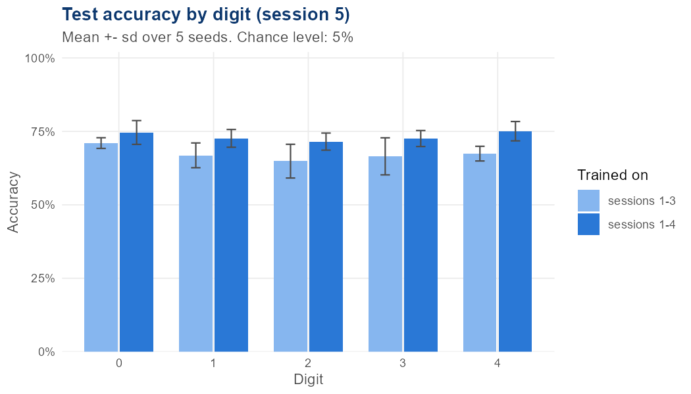{#fig-cnn-digit}

The average hides large differences between writers (@fig-cnn-writer). `r n_writers_90` of the 20 writers are recognised in at least 90% of cases. At the other end, writer `r worst$person_id` is almost never recognised (`r pct(worst$accuracy)`), and the correct writer is rarely even among the top three (`r pct(worst$top3_accuracy)`). For other weak writers, such as writers `r knitr::combine_words(confused$person_id)`, top-1 accuracy is low (`r pct_range(confused$accuracy)`), but top-3 accuracy is high (`r pct_range(confused$top3_accuracy)`). These writers are confused with a few similar writers rather than being unrecognisable (see the confusion matrix in @fig-confusion).

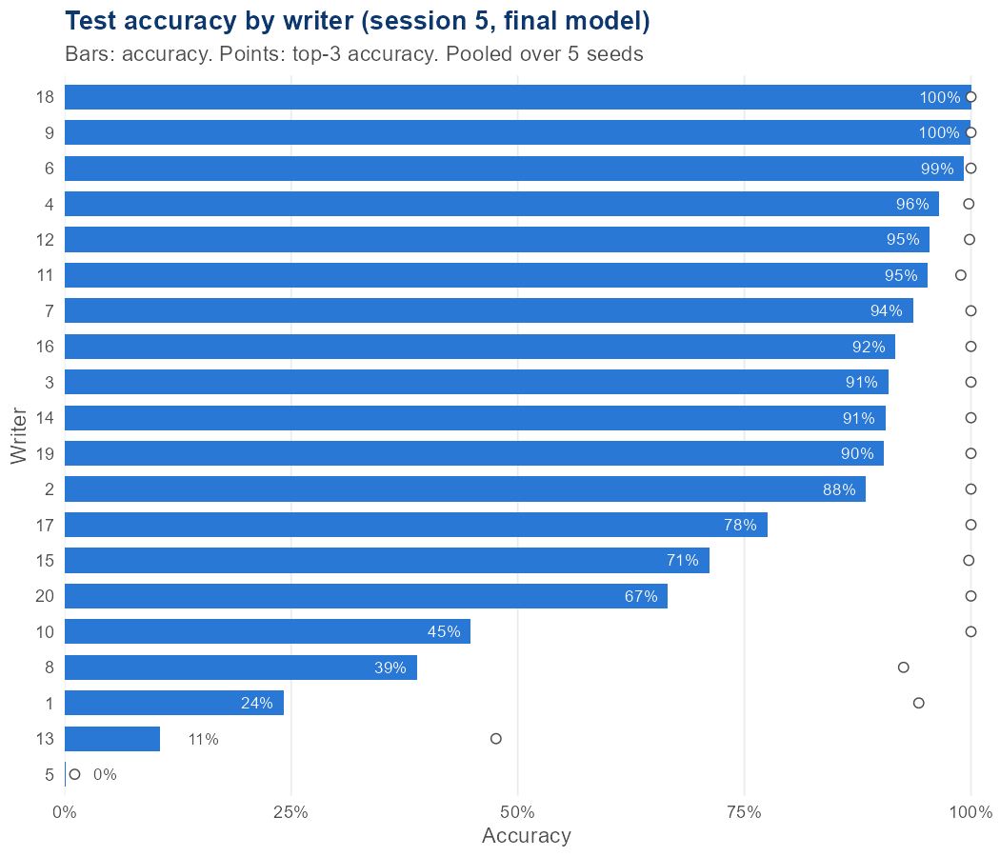{#fig-cnn-writer}

In practice, a document usually contains more than one digit. We therefore combined the predictions for k randomly drawn test images of the same writer by summing their log-probabilities. @fig-cnn-images shows that this raises accuracy only from `r pct(agg$accuracy_mean[agg$k == 1])` with one image to `r pct(agg$accuracy_mean[agg$k == max(agg$k)])` with `r max(agg$k)` images. If the errors were random from image to image, combining images would quickly remove them. The small gain shows that the errors are systematic: when the model fails for a writer in session 5, it fails for most of that writer's images. This is consistent with the writer-specific drift found in @sec-exploration.

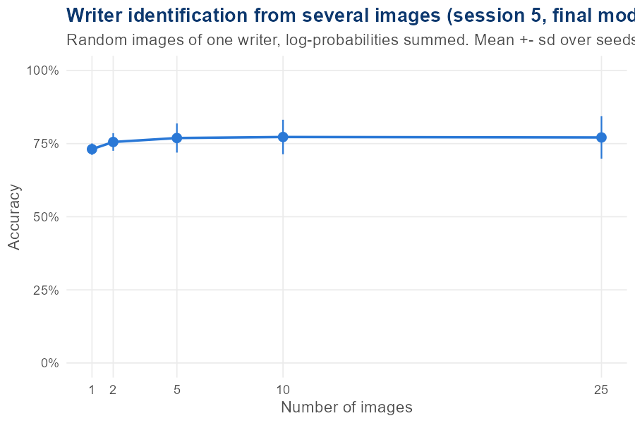{#fig-cnn-images}

## What the evaluation measures mean in practice

Accuracy is the probability that a single digit is assigned to the right person. At `r pct(acc_final$accuracy_mean, 0)` this is far above chance, but not reliable enough for an automatic decision about who wrote a digit. Top-3 accuracy describes a different use case: the model proposes a short list of three candidates, which a human examiner then checks. For this purpose the model is much more useful, as the true writer is on the list in `r pct(acc_final$top3_accuracy_mean, 0)` of cases. The results per writer add an important caveat. The average hides writers who are almost never recognised, so in practice the model would be reliable for some people and fail for others. Finally, all results refer to a closed set of 20 known writers. A person who was not in the training data cannot be identified by this model at all.

# Siamese Network for Same-Writer Matching {#sec-siamese}

<!-- Owner: Daniele | ~850 words | Brief Task 3 (task_3/siamese_network.R) -->

## Architecture and contrastive loss

A Siamese network asks a different question than the CNN. Instead of naming which of the 20 writers wrote an image, it looks at two images and decides if the same person wrote both. Both images pass through the same small convolutional network, called the encoder, using the same weights for each image, which is why the model is called "Siamese", or twin. The encoder works like this: a convolutional layer (16 filters) with max pooling, a second convolutional layer (32 filters) with max pooling, global average pooling, then a dense layer that outputs an *embedding*: a short list of numbers summing up the handwriting style of one image. The two embeddings are then compared using Euclidean distance, the model's only output. A small distance should mean "same writer", a large distance "different writer".

The model is trained with contrastive loss [@hadsell2006]. For a same-writer pair, the loss punishes the model if the two embeddings are far apart. For a different-writer pair, it only punishes embeddings that are closer than a set margin: once two different writers' embeddings are far enough apart, there is no extra reward for pushing them further. The embedding size and margin are both hyperparameters. The final model uses an embedding size of 16 and a margin of 0.5, picked by the search described in @sec-hyperparameters.

## Constructing training pairs

Each training pair starts with one image, and a coin flip decides if the second image should come from the same writer or a different one, giving a roughly even 50/50 split. Both images in a pair always show the same digit. This matters: without it, the network could just learn to spot which digit is in each image instead of who wrote it, since digit shape is a much easier shortcut than handwriting style. Matching on digit forces the network to rely on style clues instead, such as slant and stroke thickness, which carry over even when the digit changes. An image is also never paired with itself.

Pairs are only built within one data split, so no image appears in more than one of training, validation or test. The project uses one session split throughout: sessions 1-3 for training, session 4 for validation, and session 5 for test (see @sec-train-test). Using this split, 8,000 pairs were built for the hyperparameter search, 2,000 for validation, and 2,000 for test. Once the best hyperparameters were chosen using validation only, the final model was retrained on 10,000 fresh pairs drawn from sessions 1-4 combined, then tested once on the untouched test pairs.

## From distance to a same-writer decision

The model only outputs a distance, not a simple yes or no, so a threshold is needed to turn a distance like 0.21 into "same writer" or "different writer". Many candidate thresholds were tried on the validation pairs, and the one with the best *balanced accuracy* was kept: the average of how often same-writer pairs are correctly caught and how often different-writer pairs are correctly caught. Balanced accuracy was used instead of plain accuracy so the model cannot score well just by leaning toward one answer. The final threshold (0.156) was locked in using validation data only, then reused as is on the test pairs, so no test information affected the decision rule.

## Matching performance

The final Siamese network was tested on 2,000 held-out pairs from session 5, which it never saw during training or tuning. It reaches 98.2% balanced accuracy: it correctly spots same-writer pairs 98.9% of the time and different-writer pairs 97.4% of the time (@tbl-siamese-results). In simple terms, given two handwriting samples, the model correctly says whether they are from the same person about 98% of the time, in a session it has never seen before.

```{r}
#| label: tbl-siamese-results
#| tbl-cap: "Siamese network balanced accuracy by data split, using the distance threshold locked in on the validation set (0.156)."
library(tibble)
library(knitr)

tibble(
  Split = c("Train (sessions 1-4)", "Validation (session 4)", "Test (session 5)"),
  `Balanced accuracy` = c("77.4%", "98.0%", "98.2%")
) |> kable(align = "lr")
```

@fig-siamese-distances shows why this works: distances for same-writer pairs cluster near zero, distances for different-writer pairs are spread out and mostly sit well above the threshold, and the overlap between the two groups is small.

```{r}
#| label: fig-siamese-distances
#| fig-cap: "Distances between embeddings for same-writer and different-writer test pairs (session 5). The dashed line is the threshold (0.156) chosen on the validation set."
include_graphics(here("task_3", "results", "test_distance_distribution.png"))
```

## Does test accuracy overstate cross-session performance?

The train balanced accuracy (77.4%) is lower than both validation and test, which looks backwards at first. Splitting the result by pair type explains why, and it changes how the headline number should be read. On training pairs, same-writer detection is only 57.2%, far below different-writer detection at 97.6%; on test, the two numbers sit close together (98.9% versus 97.4%). The reason is session structure, not a weaker model. Test pairs come only from session 5, so same-writer test pairs are always two images from one sitting, where handwriting stays most consistent. Training same-writer pairs are different: they are drawn from sessions 1-4 and often pair two sittings from the same writer, and handwriting drifts a bit between sessions, making this a genuinely harder problem. The model has learned to spot a writer well within one sitting, but the test set never checks the harder, more realistic case of matching handwriting across different sittings. So the 98.2% test balanced accuracy is best read as a measure of within-session matching, not cross-session matching.

## Quick exploration: matching across two unseen sessions

As a quick extra check, the sessions-1-3-only model, never exposed to session 4 or 5, was tested a different way: on 2,000 pairs forced to pair one session 4 image with one session 5 image, rather than the normal within-session test pairs. Balanced accuracy drops sharply to 66.6%. Same-writer pairs are now only caught 36.7% of the time, while different-writer pairs are still caught 96.5% of the time. This confirms the pattern above directly: the headline test accuracy reported earlier reflects within-session matching, and genuinely cross-session matching is much harder for this model.

# Hyperparameter Optimisation {#sec-hyperparameters}

<!-- Owner: Daniele (Siamese) + Lucas (CNN) | Brief Task 5 (the brief only requires this search for one model; both were tuned in practice, so both are reported here) -->

The brief only asks for a hyperparameter search on one of the two models. In practice both models were tuned, so both are reported here, each in its own short section below.

## CNN hyperparameter search

The first CNN results showed one main problem. The model fits the training sessions almost perfectly (training accuracy of `r pct(train_acc)`), but it transfers much less well to a new session. We therefore tuned hyperparameters that address this gap: the size of the random shift used for data augmentation, the dropout rate in the dense layer, the number of filters in the convolutional blocks and, in a second step, the depth of the network. We kept the learning rate (10⁻³) and the batch size (64) fixed, as these are robust defaults for Adam.

The tuning was done in the following steps:

1. **Baseline.** We started from the CNN in @sec-cnn without augmentation: filters 16-32-64, dropout 0.5 and no shift.
2. **One hyperparameter at a time.** We changed one hyperparameter and kept the others at their baseline values. We tried shifts of 0.05, 0.1 and 0.15, dropout rates of 0.25 and 0.7, and filters of 8-16-32 and 32-64-128.
3. **Training and evaluation.** Each configuration was trained on sessions 1 to 3 with three different seeds. We used early stopping on the validation accuracy (session 4) with a maximum of 50 epochs, and recorded the validation accuracy and the best epoch of each run. Configurations were compared by their mean validation accuracy over the three seeds.
4. **Combination.** We planned to combine the best values of all hyperparameters that improved on the baseline by more than the seed-to-seed variation. Only the shift did, so no combined configuration was needed.
5. **Depth.** On top of the best configuration so far, we tried two and four convolutional blocks instead of three. More than four blocks is not possible, as each pooling step halves the resolution (28 → 14 → 7 → 3 → 1).

We chose this one-at-a-time design instead of a full grid search for two reasons. A full grid over the values in step 2 alone has 36 configurations, or 108 training runs with three seeds, compared to the `r n_configs` configurations we trained. In addition, the seed alone changes the validation accuracy by about `r pp(seed_sd)`, so many configurations in a fine grid would not be distinguishable from each other.

@fig-sensitivity and @tbl-tuning show the results. The random shift is the only hyperparameter with a clear effect. A shift of 0.1 raises the validation accuracy from `r pct(acc_base)` to `r pct(acc_shift$mean_accuracy)` (+`r pp(acc_shift$gain_vs_reference)`), while shifts of 0.05 (`r pct(acc_exact("shift", "0.05"))`) and 0.15 (`r pct(acc_exact("shift", "0.15"))`) help less. Dropout hardly matters (`r pct(acc_exact("dropout", "0.25"))` with 0.25 and `r pct(acc_exact("dropout", "0.7"))` with 0.7). More filters make the model worse (`r pct(acc_exact("filters", "32-64-128"))`), which fits the picture of a model that already memorises the training sessions. Two blocks reach `r pct(acc_depth2$mean_accuracy)`. Four blocks give the highest mean value (`r pct(acc_depth4$mean_accuracy)`), but a closer look at the validation curve showed that this rests on a single spike at epoch 3 (65.8%, followed by 57.5%) and a plateau of about 63% afterwards. Early stopping simply picked a lucky epoch, so we did not use this configuration.

Overall, the evaluation is not very sensitive to most of the hyperparameters we varied: the changes from dropout stay within the seed noise, and more capacity only makes the model worse. The one setting that matters is the augmentation, which is consistent with the session drift found in @sec-exploration. For the final model we therefore kept three blocks with filters 16-32-64 and dropout 0.5, and added a shift of 0.1. Its median best epoch during tuning (`r epochs`) fixed the number of epochs for the final training on sessions 1 to 4.

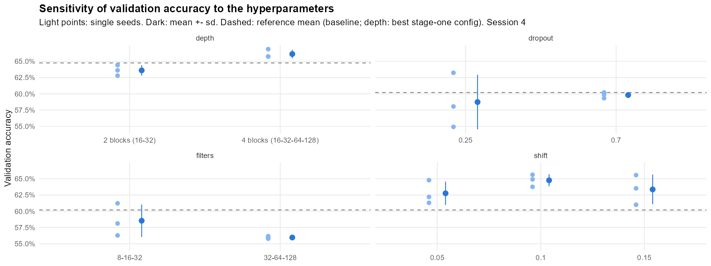{#fig-sensitivity}

```{r}
#| label: tbl-tuning
#| tbl-cap: "Validation accuracy (session 4) of all configurations, mean and sd over three seeds, with the median epoch chosen by early stopping."

summ %>%
  arrange(desc(mean_accuracy)) %>%
  transmute(Hyperparameter = hyperparameter, Value = value,
            Accuracy = pct(mean_accuracy), SD = pp(sd_accuracy),
            `Top-3` = pct(mean_top3), `Best epoch` = median_epoch) %>%
  kable(align = "llrrrr")
```

## Siamese network hyperparameter search

The search varied one hyperparameter at a time around a baseline setting, keeping everything else fixed. Two things were varied: the embedding size (8, 16 or 32) and the margin used in the contrastive loss (0.5, 1 or 2). Each setting was trained on sessions 1-3 and scored on validation (session 4) balanced accuracy, since this choice has to stay separate from the untouched test set.

@fig-siamese-hparams shows the result. All five settings land close together, between 96% and 98% balanced accuracy: baseline 97.0%, smaller embedding 97.1%, larger embedding 97.5%, smaller margin 98.0%, and larger margin 96.0%. The embedding size made almost no difference on its own, since 8, 16 and 32 all score within about half a point of each other. The margin mattered a bit more: the smaller margin (0.5) scored best and the larger margin (2) scored worst, a gap of about two points.

Since the smaller margin setting scored highest on validation, it was chosen for the final model: embedding size 16 and margin 0.5, the same values used throughout the earlier results in this report. Because the differences between settings are small, this is not a strong win, but it is still the best option found, and the model does not seem to depend heavily on getting this exact choice right.

```{r}
#| label: fig-siamese-hparams
#| fig-cap: "Validation balanced accuracy of the Siamese network for each hyperparameter setting."
include_graphics(here("task_3", "results", "hyperparameter_sensitivity.png"))
```

# Comparing the CNN and Siamese Network {#sec-comparison}

<!-- Owner: both | ~750 words | Brief Task 6 -->

## Comparing performance

<!-- Metrics aren't directly comparable: 20-class accuracy (chance 5%) vs pairwise balanced
accuracy (chance 50%). Practical trade-offs: retraining for new writers.
CNN: 73.3% (top-3 91.7%) on session 5 vs Siamese 98.2% balanced accuracy on within-session pairs. -->

## Which digits carry the most writer information

<!-- CNN accuracy by digit vs Siamese balanced accuracy by digit. Do they agree? Why?
CNN: 72-75% for all digits, differences within seed noise. Exploration: style features (slant, height) apply to all digits; the digit 1 has little individual shape. -->

## How session changes affect performance

<!-- Sessions 1-3 vs 1-4 training comparison for both models. What this says about drift.
CNN: +6.0 pp from one extra training session (67.3% -> 73.3%); errors concentrated in few writers; combining 25 images only 73% -> 77%.
Siamese: 98.2% within session 5 vs 66.6% across sessions 4/5. Both point to session drift as the main difficulty. -->

# Collaboration and Reproducibility

<!-- Owner: both | ~150 words | Brief Tasks 7 and 9
Branches (cnn, siamese-network, data_exploration, dev), pull requests, shared R/ functions,
CI workflow, renv, GitHub Pages published programmatically. -->

# Conclusion

<!-- Owner: both | ~250 words: main findings, key limitations, next steps. -->

# References {.unnumbered}

::: {#refs}
:::

# Appendix {.appendix .unnumbered}

## Pixel variance decomposition {#sec-appendix-decomposition .unnumbered}

<!-- Short explanation in your own words. -->

For each digit, with writer $p$, session $s$ and replicate $r$:

$$
\mathbf{x}_{psr} - \bar{\mathbf{x}}_{\cdot\cdot\cdot}
= \underbrace{(\bar{\mathbf{x}}_{p\cdot\cdot} - \bar{\mathbf{x}}_{\cdot\cdot\cdot})}_{\text{between writers}}
+ \underbrace{(\bar{\mathbf{x}}_{ps\cdot} - \bar{\mathbf{x}}_{p\cdot\cdot})}_{\text{between sessions}}
+ \underbrace{(\mathbf{x}_{psr} - \bar{\mathbf{x}}_{ps\cdot})}_{\text{between replicates}}
$$

$$
\underbrace{\sum_{p,s,r} \lVert \mathbf{x}_{psr} - \bar{\mathbf{x}}_{\cdot\cdot\cdot} \rVert^2}_{SS_T}
= \underbrace{SR \sum_{p} \lVert \bar{\mathbf{x}}_{p\cdot\cdot} - \bar{\mathbf{x}}_{\cdot\cdot\cdot} \rVert^2}_{SS_W}
+ \underbrace{R \sum_{p,s} \lVert \bar{\mathbf{x}}_{ps\cdot} - \bar{\mathbf{x}}_{p\cdot\cdot} \rVert^2}_{SS_{S(W)}}
+ \underbrace{\sum_{p,s,r} \lVert \mathbf{x}_{psr} - \bar{\mathbf{x}}_{ps\cdot} \rVert^2}_{SS_E}
$$

$$
\pi_W = \frac{SS_W}{SS_T}, \qquad \pi_{S(W)} = \frac{SS_{S(W)}}{SS_T}, \qquad \pi_E = \frac{SS_E}{SS_T}
$$

## Additional figures {.unnumbered}

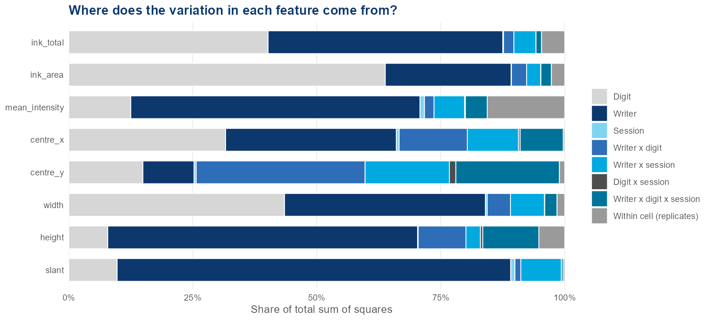{#fig-feature-variance-detail}

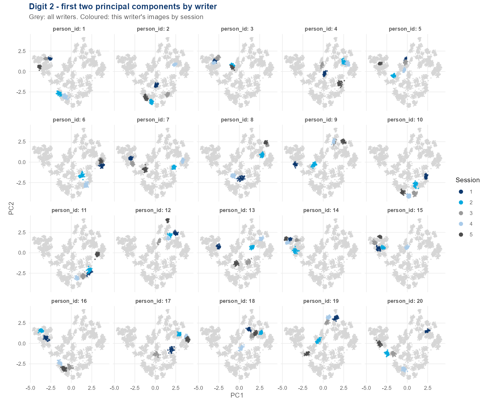{#fig-pca}


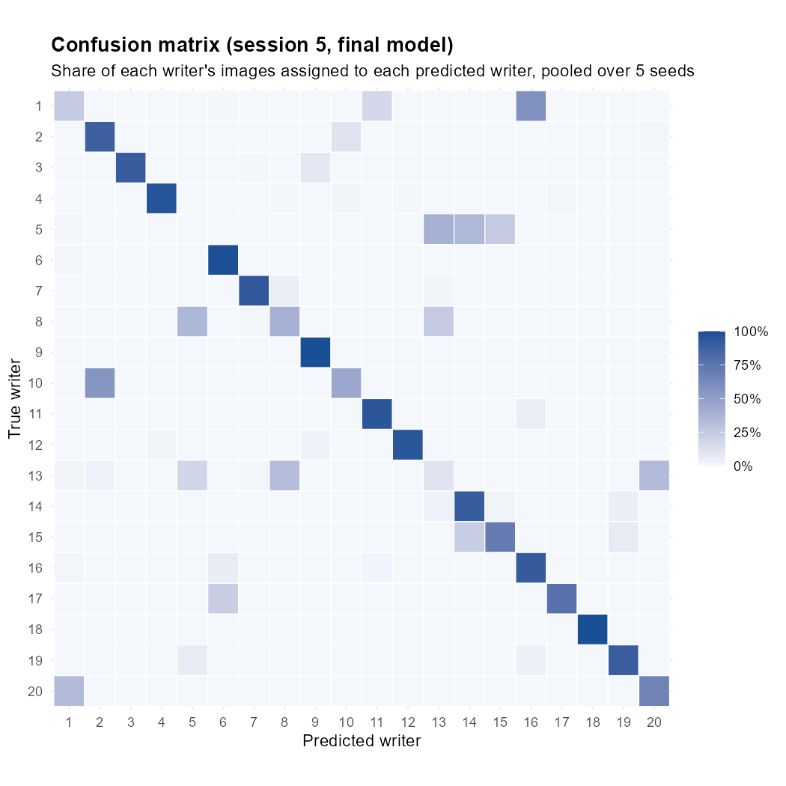{#fig-confusion}

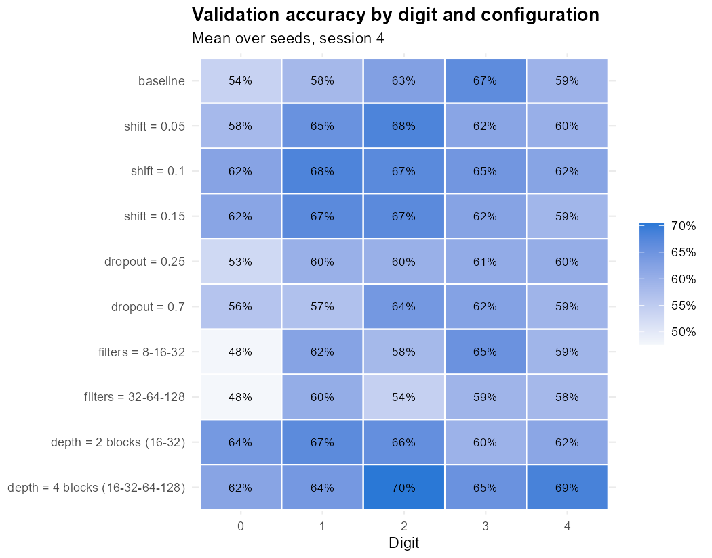{#fig-sensitivity-digit}

## Reproducing the results {.unnumbered}

Run the scripts in this order from the project root (each sources `R/setup.R`), then render this document:

1. `task_1/data_exploration.R`
2. `task_2/cnn_writer_id.R` and `task_2/learning_curves.R`
3. `task_5/cnn_tuning.R`
4. `task_2/cnn_final.R`
5. `task_3/siamese_network.R`
